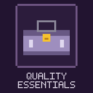

<p align="center"></p>

# QualityEssentials (QE)

[](README.md)
[](README.md)
[](README.md)
[](README.md)
[](LICENSE)

Quality of life in one mod: food, a what-am-I-looking-at panel, effect timers, armor and riding HUDs, performance overlay, shulker previews, a chat section, books, signs and a keyboard map. Every module can be turned off and steps aside when the original mod is installed.

**Руководство / User guide:** [Русский](docs/USER_GUIDE_RU.md) · [English](docs/USER_GUIDE_EN.md)

## Русский

### Что это

`QualityEssentials` (mod id `qualityessentials`) — клиентский Fabric-мод для Minecraft 26.3 от LTS_Server: набор удобств в одном моде. Каждый модуль включается и выключается в настройках и сам отключается, если установлен оригинальный мод с той же функцией.

Код написан с нуля, из оригинальных модов ничего не скопировано. Мод показывает только то, что клиент и так знает: никаких мобов сквозь стены и подсветки руд.

### Возможности

| Модуль | Что делает | Уступает место |
|---|---|---|
| Сытость | Золотые рамки насыщения поверх полосы еды, мигающее превью еды в руке, сытость и насыщение в подсказке | AppleSkin |
| Что это | Панель сверху: блок или существо в прицеле, рост, сигнал и другие свойства блока, нужный инструмент, прогресс ломания, здоровье и броня, профессия жителя, скорость и прыжок лошади, мод-источник | Jade, WTHIT |
| Таймеры эффектов | Оставшееся время и уровень на иконках эффектов | Status Effect Timer, Status Effect Bars |
| Броня и инструменты | Прочность брони и предметов в руках, стрелы для лука и арбалета, сколько всего блоков в инвентаре; три положения | Armor HUD, Armor Durability HUD |
| Езда | Полоса сытости игрока не пропадает при езде, панель животного: здоровье, максимальная скорость, высота прыжка, текущая скорость | Better Mount HUD |
| Производительность | Оверлей FPS (и 1% low), пинг и оценка TPS сервера на сервере, настоящие TPS и MSPT в одиночной игре, память, сущности, координаты (скрываются при reduced debug info), время суток с номером дня (синим, когда можно спать) и погода на месте игрока | FPS Display |
| Шалкеры | Содержимое шалкера и предметов-контейнеров сеткой в подсказке при зажатом Shift, режим сводки; поставленный шалкер показывает то, что мод запомнил при последнем открытии | Shulker Box Tooltip |
| Новые предметы | Маленькая звёздочка на только что подобранных предметах в инвентаре, исчезает при наведении | Item Highlighter |
| Подробности о предмете | С зажатым Shift подсказка возвращает строки, спрятанные сервером компонентом `tooltip_display`, и показывает ID, модель, прочность, цену ремонта, редкость и данные сервера | — |
| Скриншоты | Кнопки «Открыть», «Папка» и «Копировать путь» у сообщения о сохранённом скриншоте | — |
| Чат | Длинная история и её возврат после перезахода, большое окно, время сообщений, склейка повторов, исправление раскладки, вкладки, поиск, отправка длинных сообщений частями (см. ниже) | Chat Patches |
| Книги | Цвета и стили в книге с пером, работа со страницами, вставка длинного текста, отмена, файлы; копирование при чтении (см. ниже) | Scribble |
| Таблички | Копирование и вставка всех строк, работа мышью и Tab, палитра &-кодов, автозаполнение новой таблички (см. ниже) | — |
| Тёмный экран загрузки | Тёмный фон вместо красной вспышки при запуске и перезагрузке ресурспаков | Dark Loading Screen |
| Схема клавиатуры | Бывший BindBoard: вся клавиатура с нампадом и мышью, бинды, конфликты, слои Ctrl/Shift/Alt, переназначение | BindBoard |

Панели «Что это», «Броня и инструменты», «Езда» и «Производительность» двигаются в редакторе HUD: перетаскивание с привязкой к краям и центру, колесо меняет размер, отдельно настраивается прозрачность фона. Позиция хранится относительно ближайшего края или центра, поэтому не съезжает при другом разрешении.

#### Чат, книги и таблички

Подробное описание этих разделов: [справочник возможностей](docs/USER_GUIDE_RU.md#справочник-возможностей). Раздел чата перенесён из Callout, там остались оповещения и история упоминаний.

| Раздел | Что есть |
|---|---|
| Чат | История до 16 384 сообщений, возврат последних 1000 после перезахода, размер окна, время сообщений, склейка повторов, вкладки с правилами, поиск `Ctrl+F`, длинные сообщения частями, исправление раскладки |
| Книги | 16 цветов и стили, работа со страницами, вставка длинного текста с переносом на новые страницы, отмена, сохранение и загрузка файлов, копирование при чтении, название до 32 символов |
| Таблички | Копирование и вставка всех строк, мышь и `Tab`, отмена, палитра &-кодов, запоминание текста и автозаполнение новой таблички |

### Управление

| Клавиша | Действие |
|---|---|
| `F10` | Открыть схему клавиатуры (также кнопка в «Настройки → Управление → Привязки клавиш») |
| `Pause` (в открытом чате) | Перевести раскладку выделенного текста или всей строки |
| не назначена | Открыть настройки QE |
| не назначена | Редактор расположения HUD |
| `Ctrl+F`, `Ctrl+Tab` / `Ctrl+Shift+Tab` (в чате) | Поиск по истории, переключение вкладок чата |

Клавиши назначаются в «Настройки → Управление», категория QualityEssentials. Сочетания книг и табличек описаны в [справочнике возможностей](docs/USER_GUIDE_RU.md#справочник-возможностей).

### Настройки

Экран **Mod Menu → QualityEssentials** (или своя клавиша) собран на ванильных вкладках и строках: каждый модуль включается отдельно, там же кнопки редактора HUD и «Правила вкладок» чата.

| Путь | Что хранит |
|---|---|
| `config/qualityessentials.json` | Общие настройки |
| `config/qualityessentials/chat/` | Чат после перезахода |
| `config/qualityessentials/shulkers/` | Запомненные шалкеры, отдельно для каждого сервера и мира, до 4096 ящиков |
| `config/qualityessentials/chat_tabs.json` | Правила вкладок |
| `config/qualityessentials/books/` | Книги |

InfoMod открывает схему клавиатуры через `QualityEssentialsClient.createKeyboardScreen(Screen)`.

### Установка

1. **Fabric Loader** `0.19.3+` и **Fabric API**.
2. Скопируйте `quality-essentials-1.1.6.jar` из `build/libs/` в папку `mods/`.
3. **Mod Menu** — опционально, открывает экран настроек.

**Требования:** Minecraft `26.3` · Java `25` · только клиент.

### Сборка

```powershell
.\gradlew.bat clean build
```

Готовый JAR: `build/libs/quality-essentials-1.1.6.jar`.

Игровой тест:

```powershell
.\gradlew.bat runClientGameTest
```

Тест открывает книгу, вставляет длинный цветной текст, красит выделение, отменяет, сохраняет и загружает файл, проверяет чтение книги, таблички (вставку, отмену, автозаполнение) и настройки на русском, в окне 1280×720 и 854×480. Скриншоты — в `build/run/clientGameTest/screenshots`.

---

## English

### What It Is

`QualityEssentials` (mod id `qualityessentials`) is a client-side Fabric mod for Minecraft 26.3 by LTS_Server: quality-of-life features in one mod. Every module can be switched on and off in the settings and turns itself off when the original mod with the same feature is installed.

The code is written from scratch; nothing is copied from the original mods. The mod only shows what the client already knows: no mobs through walls and no ore highlighting.

### Features

| Module | What it does | Steps aside for |
|---|---|---|
| Food | Gold saturation outlines over the hunger bar, a blinking preview of the food in hand, hunger and saturation in the tooltip | AppleSkin |
| What is this | A panel at the top: the block or entity under the crosshair, growth, signal and other block properties, the right tool, breaking progress, health and armor, villager profession, horse speed and jump, source mod | Jade, WTHIT |
| Effect timers | Remaining time and level on effect icons | Status Effect Timer, Status Effect Bars |
| Armor and tools | Durability of armor and held items, arrows for bows and crossbows, how many blocks of a kind are in the inventory; three positions | Armor HUD, Armor Durability HUD |
| Riding | The player's hunger bar stays visible while riding; a mount panel: health, top speed, jump height, current speed | Better Mount HUD |
| Performance | FPS overlay (and 1% low), ping and an estimated server TPS on servers, real TPS and MSPT in singleplayer, memory, entities, coordinates (hidden with reduced debug info), time of day with the day number (blue when you can sleep) and the weather at the player | FPS Display |
| Shulkers | With Shift held, the contents of a shulker box or container item as a grid in the tooltip, a summary mode; a placed box shows what the mod remembered when it was last opened | Shulker Box Tooltip |
| New items | A small star on just-picked-up items in the inventory, gone on hover | Item Highlighter |
| Item details | With Shift held, the tooltip brings back lines the server hid with the `tooltip_display` component and shows ID, model, durability, repair cost, rarity and server data | — |
| Screenshots | Open, Folder and Copy path buttons on the saved-screenshot message | — |
| Chat | Long history restored after rejoining, a bigger window, timestamps, merged repeats, keyboard layout fix, tabs, search, long messages sent in parts (details below) | Chat Patches |
| Books | Colours and styles in the book and quill, page tools, pasting long text, undo, files; copying while reading (details below) | Scribble |
| Signs | Copy and paste all lines, mouse and Tab editing, an &-code palette, auto-filling a freshly placed sign (details below) | — |
| Dark loading screen | A dark background instead of the red flash on start and resource pack reloads | Dark Loading Screen |
| Keyboard map | Formerly BindBoard: the whole keyboard with numpad and mouse, bindings, conflicts, Ctrl/Shift/Alt layers, rebinding | BindBoard |

The What is this, Armor and tools, Riding and Performance panels move in the HUD editor: drag with snapping to edges and the centre, the wheel changes the size, and the background opacity is set separately. A position is stored relative to the nearest edge or the centre, so it stays put at another resolution.

#### Chat, books and signs

A detailed description of these sections: [feature reference](docs/USER_GUIDE_EN.md#feature-reference). The chat section moved here from Callout, which keeps the alerts and the mention history.

| Section | What is there |
|---|---|
| Chat | History up to 16,384 messages, the last 1,000 restored after rejoining, window size, timestamps, merged repeats, tabs with rules, `Ctrl+F` search, long messages in parts, keyboard layout fix |
| Books | 16 colours and styles, page tools, pasting long text across new pages, undo, saving and loading files, copying while reading, titles up to 32 characters |
| Signs | Copying and pasting all lines, mouse and `Tab` editing, undo, an &-code palette, remembering text and filling a new sign |

### Controls

| Key | Action |
|---|---|
| `F10` | Open the keyboard map (also a button in Options → Controls → Key Binds) |
| `Pause` (in the open chat) | Convert the layout of the selected text or the whole line |
| unbound | Open the QE settings |
| unbound | HUD layout editor |
| `Ctrl+F`, `Ctrl+Tab` / `Ctrl+Shift+Tab` (in chat) | Search the history, switch chat tabs |

Keys are bound in Options → Controls, category QualityEssentials. Book and sign shortcuts are listed in the [feature reference](docs/USER_GUIDE_EN.md#feature-reference).

### Configuration

The **Mod Menu → QualityEssentials** screen (or its own key) is built on vanilla tabs and option rows: every module is switched separately, and the HUD editor and chat Tab rules buttons are there too.

| Path | Holds |
|---|---|
| `config/qualityessentials.json` | Main settings |
| `config/qualityessentials/chat/` | Chat restored after rejoining |
| `config/qualityessentials/shulkers/` | Remembered shulker boxes, per server and world, up to 4096 boxes |
| `config/qualityessentials/chat_tabs.json` | Tab rules |
| `config/qualityessentials/books/` | Books |

InfoMod opens the keyboard map through `QualityEssentialsClient.createKeyboardScreen(Screen)`.

### Installation

1. **Fabric Loader** `0.19.3+` and **Fabric API**.
2. Copy `quality-essentials-1.1.6.jar` from `build/libs/` into `mods/`.
3. **Mod Menu** is optional and opens the settings screen.

**Requirements:** Minecraft `26.3` · Java `25` · client-only.

### Building

```powershell
.\gradlew.bat clean build
```

Output JAR: `build/libs/quality-essentials-1.1.6.jar`.

In-game test:

```powershell
.\gradlew.bat runClientGameTest
```

The test opens a book, pastes a long coloured text, colours a selection, undoes, saves and loads a file, and checks book reading, signs (paste, undo, auto-fill) and the settings in Russian, in 1280×720 and 854×480 windows. Screenshots go to `build/run/clientGameTest/screenshots`.

## Лицензия / License

[MIT](LICENSE). Developed by LTS_Server.
